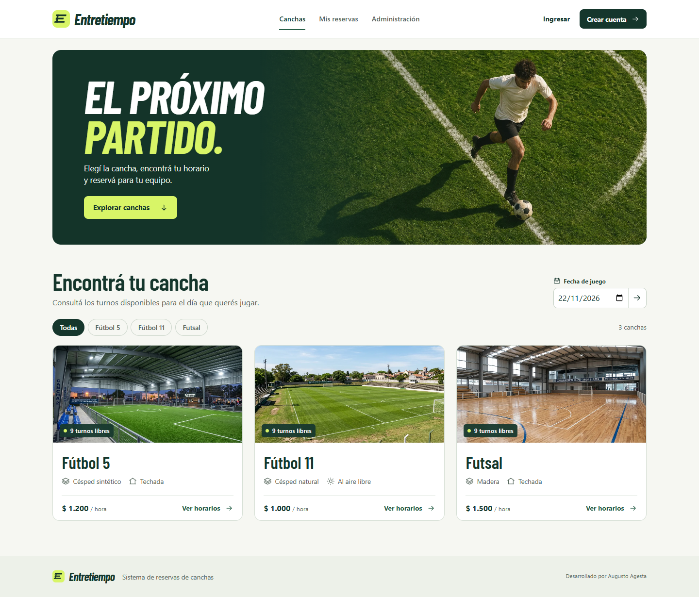
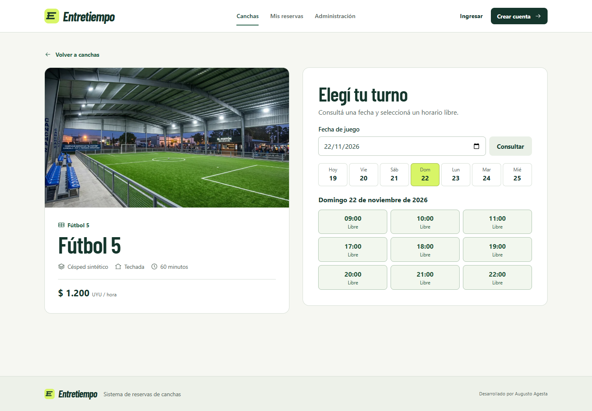
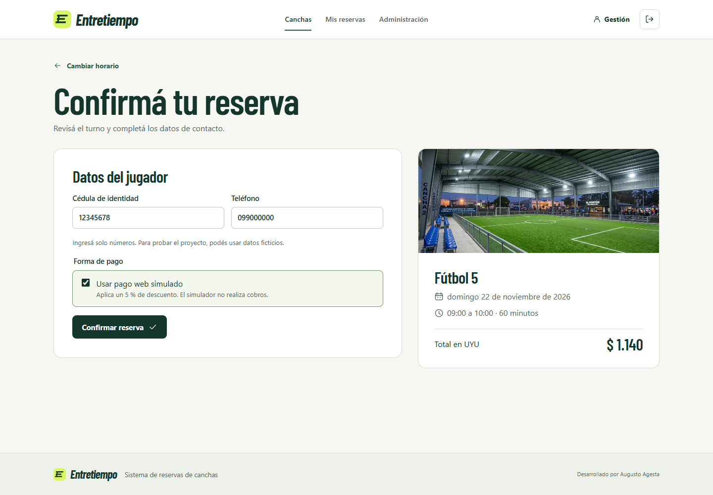
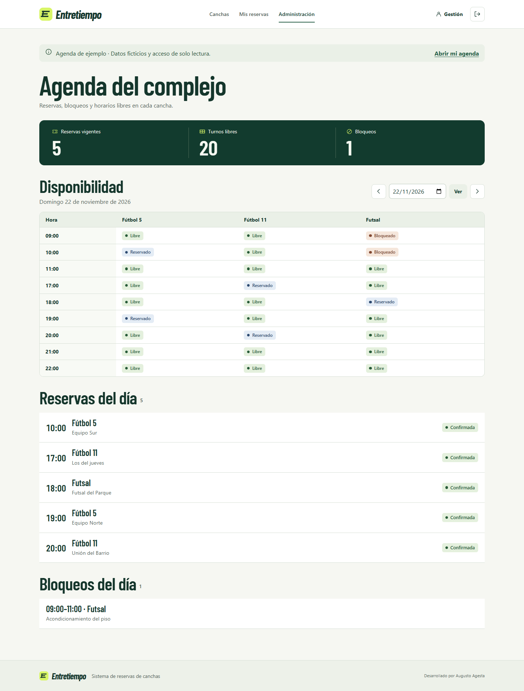

# Entretiempo · Sistema de Reservas de Canchas

Aplicación web para gestionar la reserva de canchas de fútbol, con roles diferenciados de cliente y administrador. Desarrollada en Python con Flask, HTML/CSS/JS y SQLite.

Este es mi segundo proyecto de portfolio, como estudiante de 3er año de Licenciatura en Informática (Uruguay). A diferencia de mi primer proyecto (una app de escritorio), esta es mi primera aplicación web completa, desarrollada desde cero sin experiencia previa en HTML, CSS, JavaScript ni Flask.

> **Nota de transparencia:** este proyecto lo construí con la ayuda de Claude (Anthropic) como asistente de programación, principalmente para aprender HTML/CSS/JS y Flask desde cero, resolver dudas de sintaxis y debuggear errores. La arquitectura, la lógica de negocio y las decisiones de diseño del sistema son mías.

## Recorridos del portfolio

Desde el catálogo podés comparar canchas, consultar la disponibilidad de una fecha y elegir un turno. Si necesitás ingresar o registrarte, se conserva el partido seleccionado. En **Mis reservas** podés revisar y cancelar tus próximos turnos.

Desde **Administración** podés entrar con una cuenta del complejo o abrir la **agenda de ejemplo** en `/admin/demo`. Esta vista utiliza datos ficticios en memoria. El panel real permite gestionar la agenda, las canchas, los bloqueos y las estadísticas.

## Funcionalidades

**Cliente:**
- Registro y login con contraseña hasheada
- Ver canchas disponibles con fotos, precio y descripción
- Ver disponibilidad horaria por fecha, con estados visuales (disponible / ocupado / pasado)
- Reservar un horario, con cédula, teléfono y opción de pago web (5% de descuento simulado)
- Próximos partidos e historial propio, con cancelación antes del inicio
- Filtros por formato y fecha, disponibilidad actualizada y resumen del importe en pesos uruguayos

**Administrador:**
- Agenda diaria por cancha y horario con navegación a cualquier fecha
- Cancelación de reservas
- Gestión de canchas (agregar, editar, activar/desactivar)
- Bloqueo de horarios por mantenimiento o eventos, con eliminación
- Estadísticas del negocio (total de reservas, cancha más reservada, ingresos estimados)

**General:**
- Protección de rutas por rol (decoradores `login_requerido` / `admin_requerido`)
- Validaciones de formato (email, contraseña, teléfono, cédula)
- Página 404 personalizada
- Diseño responsivo con paleta e identidad visual propia

## Capturas de pantalla

| Página principal | Detalle de cancha |
|---|---|
|  |  |
| Confirmación de reserva | Agenda de ejemplo |
|---|---|
|  |  |

La portada utiliza una imagen editorial generada con IA. El catálogo conserva las fotografías originales de las canchas. La tipografía Barlow Condensed se distribuye localmente bajo la licencia incluida en `static/fonts/OFL.txt`.

## Proceso de diseño

Antes de programar, diseñé el sistema completo en papel/texto y paint: entidades de la base de datos, relaciones, flujo de navegación y bocetos de las pantallas principales (cliente y admin). Podés verlos en la carpeta [`prototipos/`](prototipos/).

## Tecnologías

- **Python / Flask** — backend y rutas
- **Jinja2** — plantillas HTML dinámicas
- **HTML / CSS / JavaScript** — frontend
- **SQLite** — base de datos
- **Werkzeug** — hasheo de contraseñas

## Arquitectura

El proyecto sigue una arquitectura en capas:

```
sistema-reservas-canchas/
    app.py
    database/       # Conexión y schema de la base de datos
    logica/         # Lógica de negocio (disponibilidad de horarios)
    routes/         # Rutas de Flask (cliente y admin)
    templates/      # Vistas HTML (Jinja2)
    static/         # CSS, JS e imágenes
    utils/          # Decoradores de autenticación
```


## Cómo correrlo

1. Cloná el repositorio:
```bash
git clone https://github.com/AugustoAgesta/sistema-reservas-canchas.git
cd sistema-reservas-canchas
```

2. Instalá las dependencias:
```bash
pip install -r requirements.txt
```

3. Creá un archivo `.env` en la raíz del proyecto con una clave secreta propia:

SECRET_KEY=tu-clave-secreta-aca


4. Ejecutá la aplicación:
```bash
python app.py
```

Abrí `http://127.0.0.1:5000/`. La primera ejecución crea la base con tres canchas de muestra. Al abrir una base anterior se incorpora el teléfono de la reserva. Para las reservas antiguas, el panel usa el contacto actual del perfil cuando está disponible.

Para correr las pruebas de reserva simultánea, cancelación, bloqueos y migración, ejecutá `python -m unittest discover -s tests -v`. Las pruebas utilizan bases temporales. Para usar otra base local, configurá la variable de entorno `CANCHAS_DB` con su ruta.

### Crear una cuenta de administrador

Por defecto, cualquier cuenta que se registre es un cliente normal. Para convertir una cuenta en administrador:

1. Registrate normalmente desde `/registro`
2. Con el servidor detenido, ejecutá en la terminal (reemplazando el email):
```bash
python -c "from database.db import get_connection; conn = get_connection(); conn.execute('UPDATE usuario SET es_admin = 1 WHERE email = ?', ('tu_email@ejemplo.com',)); conn.commit(); conn.close()"
```

## Autor

**Augusto Agesta**
Estudiante de Licenciatura en Informática — Uruguay
[LinkedIn](https://www.linkedin.com/in/augusto-agesta-cabrera-86110b311) | [GitHub](https://github.com/AugustoAgesta)

